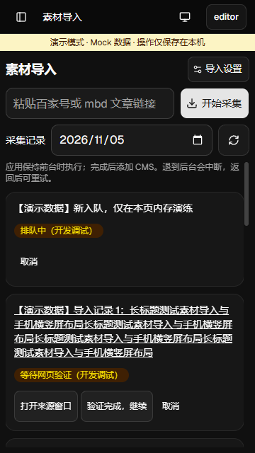
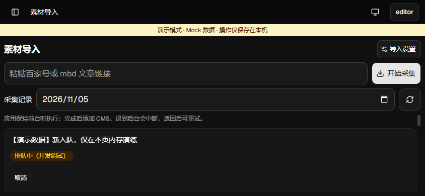
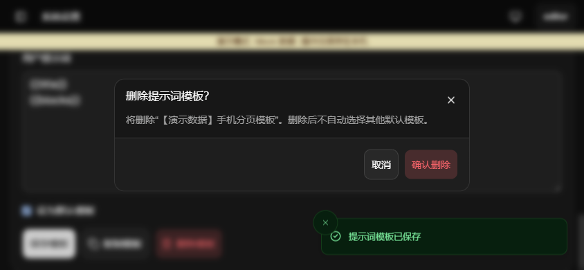
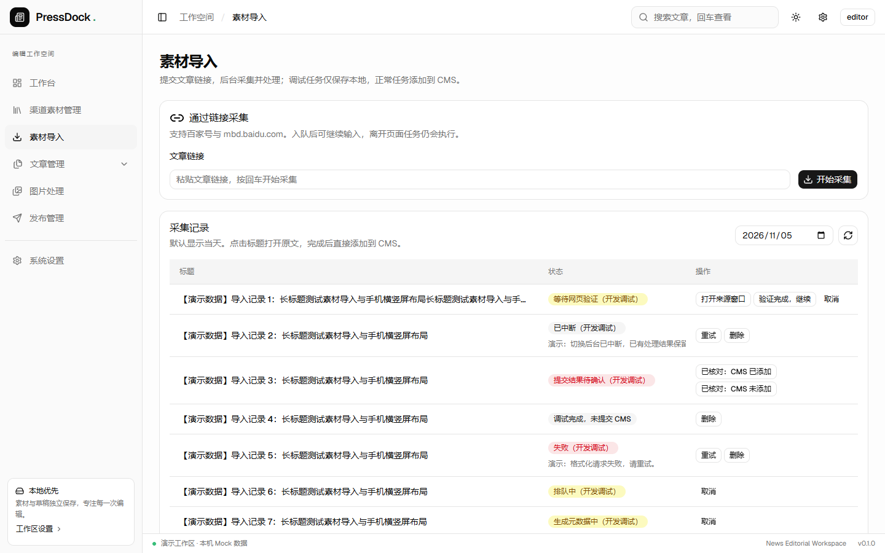

# Android 素材导入验收

验收日期：2026-11-05。渠道详情、修改素材和 TitlePic／TitlePic2 的既有弹框修复保留，记录见 [渠道弹框验收](android-channel-dialogs-qa.md)。

## 实现范围

- Android 开放素材导入及采集／AI 模型／分页模板配置。手机横屏继续使用记录卡片，输入区和工具区保持可见，记录独立滚动。未提交链接只留在本次账号会话内存，换号／退出清除。
- 原生来源 WebView 与业务 WebView 分开；首次 loadUrl 前设置 Windows Chrome UA，版本来自设备内核，移除 Android、Mobile、wv 和 Version/4.0。整个实例不再次改 UA，重建时重设；宽视口、页面概览及缩放可用于 PC 验证页面。
- 沿用静态 PC DOM 选择器、30 页／10 MiB 单页／16 MiB 合并正文限制与空正文等待验证流程。Android 仅允许 HTTPS 百度来源导航，不放宽证书、明文或来源策略。
- 工作器重复启动受保护，原生 ProcessLifecycleOwner 控制执行。离开页面不中止，退后台取消活动处理、释放来源视图；快速后台／前台往返也保留中断。返回继续排队任务，中断记录须手动重试。
- 复用现有格式化、AI 分类／标签／摘要、V9 自动分页和 CMS 创建流程。提交意图已写入时发生中断或结果不明，先核对 CMS；确认未添加只标为失败，不立即重发。
- Android AI 凭据使用独立 Keystore AES-GCM 密钥和 noBackupFilesDir 密文，UUID 引用作为 AAD，同目录临时写入、同步后原子替换。配置失败回滚、删除清理沿用现有服务。
- Android 主窗口仅增加导入与 AI 配置／测试权限；来源 WebView 无 Tauri bridge、业务 IPC、CMS 凭据或 AI 密钥。桌面窗口、CDP、油猴及原有布局保持。
- 演示包无 INTERNET 权限，原生采集及 Rust 采集／AI 请求入口显式拒绝真实网络。导入完整交互在隔离浏览器宿主演练，不冒充真实 CMS 成功。

## 隔离验证

ego-browser 使用一个任务空间，分别加载 Android 和桌面构建标识的本机 Vite 宿主。宿主直接渲染正式组件，认证、采集、AI、图片预设及系统信息均使用明确标注的演示替身；草稿和结果仅存内存。正式登录入口和认证限制未改动。

浏览器最终计数：真实 CMS 写入 0、真实 AI 请求 0、意外原生 IPC 0。模型测试调用仅进入内存替身。未读取真实业务数据库或系统凭据；Rust 测试使用临时数据库、本机模拟接口及内存凭据。

## 浏览器尺寸与交互

| 构建配置                 | 视口               | 实测结果                                                      |
| ------------------------ | ------------------ | ------------------------------------------------------------- |
| Android                  | 360×640            | 记录区 x=8、y=228、344×404，底部 632；输入高 44，无横向溢出   |
| Android                  | 390×844            | 记录区 x=8、y=228、374×608，底部 836；输入高 44，无横向溢出   |
| Android 横屏             | 844×390            | 保持卡片布局；记录区 828×154，底部 382；可独立滚动            |
| Android 键盘压缩高度模拟 | 390×400            | 记录区 374×164，底部 392；输入和工具区仍在视口内              |
| 桌面                     | 1280×800、1440×900 | 使用原表格及七个设置标签，确认框无 Android 标记，维持居中布局 |

已操作入队失败／重试、验证打开／继续、取消、错误重试、CMS 结果核对、采集设置保存失败／重试、提供商保存、模型测试／删除取消、分页模板编辑保存／删除取消，以及设置往返和横竖屏切换。入队失败保留链接，两次请求使用同一个 UUID；核对未添加只发送 confirmNotSubmitted，没有自动 retry。

设置往返后原链接草稿完整恢复。记录滚动时背景 scrollY 保持 0。模板确认框在 844×390、360×640 和 390×400 均在视口内，关闭／取消／确认按钮中心命中自身，无覆盖；模型及 CMS 核对弹框也可点击。

## PC UA 与选择器

本机测试站根据 HTTP User-Agent 返回不同 HTML：PC UA 返回 #header、author-name 和 article 标签；手机 UA 只返回 mobile-only，不能被 PC 选择器匹配。浏览器直接运行仓库中的静态 SNAPSHOT 脚本，没有另写解析器。

首次请求、刷新、后续分页、验证返回及新建页面重设 UA 后，navigator.userAgent 与服务器记录均为 Windows Chrome UA，articleCount=1，成功读取演示标题、作者、正文及下一页。302 重定向前后两次请求仍为同一个 PC UA。手机 UA 对照的 articleCount=0、html 为空。原始脱敏结果见 [UA 验证数据](qa/android-import/ua-evidence.json)。

JVM 测试另外验证原生 UA 策略的实际内核版本保留、移动标识移除、不可识别／过旧版本拒绝、来源白名单与相似域名／危险协议拒绝，以及 AI 密文跨引用替换和篡改拒绝。

## 自动化与编译

前端完整回归 31 个文件、235 项通过，包含 Android 状态订阅、配置往返、账号清稿、核对结果、入队幂等和桌面分支；原有渠道嵌套弹框测试也通过。全量测试采用 --maxWorkers=2，避免本机并行编译时资源争用。既有 Select 测试改为等待异步弹层出现。

Rust 默认回归 71 项通过、4 项原有人工／付费配置用例忽略。新增测试覆盖原生前后台 gate、快速往返中断、Android 最小权限、临时 SQLite 中断检查点、取消、换号拒绝、重启恢复、提交未知禁止重试／删除以及原文不可覆盖。现有本机 AI 协议、取消、超时、凭据失败回滚与分页回退测试通过。

ESLint、TypeScript／Vite、Prettier、cargo fmt、默认及 android-demo 功能的 Clippy 检查通过；README 两组脚本测试共 9 项通过。Android 正式／演示配置均编译 ARM64 调试 APK，原生策略及加密 JVM 测试 3 项通过。演示 APK 合并清单确认没有 INTERNET 权限；两种 APK 均通过 v2 签名和 16 KiB ZIP 对齐检查。Windows MSI／NSIS 安装包构建通过。

最终 APK 保存在本机忽略的 artifacts 目录，未安装：

| 文件                              | 大小（字节） | SHA-256                                                          |
| --------------------------------- | ------------ | ---------------------------------------------------------------- |
| PressDock-android-debug-arm64.apk | 45155701     | 49ba7bf5ab1a650a5b559bd8d4c8045fed3e3e244251b8413e8daee5ba2a5129 |
| PressDock-android-demo-arm64.apk  | 44624173     | bb3feab5c28b1b2a7d4f0423855e10402043e5d72d667d2074b1010b7c0d80dc |

Windows 不允许符号链接时，沿用仓库构建脚本复制本次原生库并执行 Gradle 打包；未修改系统开发者模式。最终确认框为上下／左右两边对称预留较大的安全区，无安全区时与截图尺寸一致；原生安全区仍属于下述运行验收边界。

## 验证边界

ego 证明浏览器布局、交互及 PC UA／选择器契约，JVM 测试证明纯策略及加密封装；二者不能替代 Android 系统 WebView、Keystore、原生 Dialog、系统生命周期和真实 IME 的运行验收。本次仅编译正式／演示 Android 配置，不连接设备、不安装或运行 APK。真实来源站验证、系统 Keystore 读写、Android 原生视图与系统前后台行为仍需后续原生运行验证。

未调用付费 AI、未修改真实 CMS 数据。本次未新增后台服务、常驻通知、数据库迁移或前端 IPC 契约。
