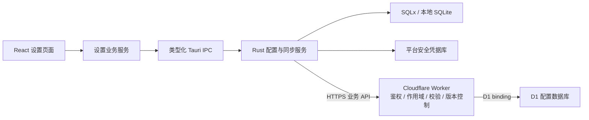

# Cloudflare D1 统一设置可行性调研

调研日期：2026-11-07。依据当前工作区代码与 Cloudflare 官方文档；本文是方案评估，尚未创建云资源、部署服务或进行跨设备联调。

需求更新：用户已明确采用不按账号隔离的全局共享配置，软件每次打开读取一次，修改时上报，并同步由服务端加密保存的 AI 密钥。最新决策见[全局设置方案](cloudflare-d1-settings-plan.md)；下文有关账号隔离、轮询拉取与密钥仅保留本机的建议是前期候选，不作为当前实施要求。

## 结论

可以使用 Cloudflare D1 存储 PressDock 的共享配置，适合模型参数、提示词模板、图片预设和采集处理规则这类体积小、低频修改的数据。建议采用 **Workers 提供业务 API、D1 保存云端版本、本地 SQLite 保存可用副本与待同步修改** 的方案。

“全平台统一”建议首先定义为同一账号在 Windows、macOS、Android 上使用同一份业务配置；多人共享另设工作区及管理员权限。设备专属配置保留本地，密钥作为独立能力设计。D1 接入本身不会让尚未实现的平台成为可用客户端；当前纯浏览器仍只有登录预览入口。

D1 负责数据库存储，身份校验、权限、跨端同步及冲突处理仍需应用实现。Cloudflare 官方建议外部应用通过 Worker API 访问 D1，内置 D1 REST API 更适合管理用途。[官方接入建议](https://developers.cloudflare.com/d1/tutorials/build-an-api-to-access-d1/)

## 项目现状

| 配置            | 当前存储与代码依据                                                           | 对统一配置的影响                                               |
| --------------- | ---------------------------------------------------------------------------- | -------------------------------------------------------------- |
| AI 提供商、模型 | SQLite：`ai_providers`、`ai_models`；`src-tauri/src/database/ai.rs`          | 可以同步提供商地址、协议、兼容参数和模型参数                   |
| 标题与分页模板  | SQLite：`ai_prompt_templates`；迁移 `0003`、`0006`、`0009`                   | 应同步用途、正文、默认模板、绑定模型及分页参数，并保持引用完整 |
| 图片预设        | SQLite：`channel_image_presets`；`src-tauri/src/database/image_presets.rs`   | 可按渠道、子渠道和图片字段同步                                 |
| 采集设置        | SQLite：`harvest_settings` 单行；`src-tauri/src/harvest/store.rs`            | 同一对象混合了共享处理规则与本机采集配置，需要拆分             |
| 主题、导航      | `src/atoms/theme.ts`、`src/atoms/navigation.ts`，通过 `atomWithStorage` 保存 | 可增加账号级主题偏好；导航状态按设备保留更合适                 |
| 表格偏好        | `src/hooks/use-column-preferences.ts`，键为 `pressdock.table.<页面>.v1`      | 桌面列宽不宜直接应用到手机；当前存储键也没有账号维度           |
| AI 密钥         | 桌面 keyring；Android 经原生桥接使用安全存储；数据库只存 `credential_ref`    | 本机凭据引用无法在另一台设备使用                               |
| CMS 会话        | Rust `cms` 服务和平台凭据库                                                  | 不属于普通共享设置，不应上传 D1 配置文档                       |
| 服务与关于信息  | `src/pages/Settings/sections.tsx`；CMS 主机在 `cms/client.rs` 固定           | 服务状态、数据库健康、应用版本均由当前设备计算                 |

关键迁移问题：上述业务配置表没有账号字段。现状是同一个应用数据目录中的配置被本机账号共用，而采集任务本身使用 `user_id` 隔离。接入云端时必须补齐本地账号作用域，不能只给网络请求增加一个用户 ID。

数据库当前由 SQLx 打开本机 `pressdock.db` 并执行嵌入迁移。D1 的 SQLite 语义有利于复用数据模型，但不是替换 SQLx 文件路径即可接通的远程 SQLite。

## 建议同步范围

| 内容                                             | 第一阶段建议                       | 原因                                                             |
| ------------------------------------------------ | ---------------------------------- | ---------------------------------------------------------------- |
| AI 提供商元数据、模型参数                        | 同账号同步                         | 对各端业务行为有共同意义                                         |
| 标题优化、分页提示词及模型绑定                   | 同账号同步                         | 需要保持模型引用与默认模板约束                                   |
| 渠道图片预设                                     | 同账号同步；后续可升级为工作区共享 | 渠道出图规则可统一                                               |
| 分类、标签、摘要、AI 分页开关                    | 同账号同步                         | 属于业务处理规则；远端变更只影响之后创建的任务                   |
| 主题                                             | 可选账号同步                       | 同步 `system/light/dark`，各设备自行解析“跟随系统”               |
| 保留天数                                         | 第一阶段本地保留                   | 同步后会改变各设备的历史清理行为；如需统一，应单独作为策略开放   |
| 采集方式、CDP 浏览器、地址及数据目录             | 本机保留                           | Android 明确只支持内置 WebView；桌面目录、回环地址没有跨设备意义 |
| 开发者模式                                       | 本机保留                           | 会影响调试日志、DevTools 和是否提交 CMS                          |
| 导航折叠、列宽                                   | 本机保留                           | 与屏幕和输入方式有关；列显隐如需同步可按桌面/移动配置区分        |
| AI 密钥                                          | 独立方案；第一阶段每台设备分别设置 | 云端有模型配置不代表本机有可用密钥                               |
| CMS 令牌、Cookie、采集任务、原文、草稿、运行缓存 | 不纳入此次配置同步                 | 分别属于会话、业务数据与运行状态                                 |

“所有客户端一致”与“所有用户一致”应分别定义。默认按账号隔离；团队统一配置应绑定工作区成员关系，并为共享配置设置明确的写权限，不能让任意登录用户修改所有人的配置。

## 接入架构

客户端继续通过现有业务服务和类型化 IPC 使用 Rust，组件不直接调用云 API、`invoke` 或 SQL。Rust 使用 HTTP 客户端访问 Worker；SQLx 继续管理本地数据库。Worker 可以使用 TypeScript 和 D1 binding，实现独立的服务端校验与迁移。

不向客户端发放 Cloudflare 账户 API Token，也不开放接受任意 SQL 的接口。Worker 仅接受经过校验的设置业务请求，使用参数化 SQL；D1 binding 无需客户端持有数据库管理令牌。[D1 Worker API](https://developers.cloudflare.com/d1/worker-api/)、[代理 API 官方说明](https://developers.cloudflare.com/d1/tutorials/build-an-api-to-access-d1/)

将开发与生产数据库分开。初期一个环境使用一个 D1 数据库，按账号或工作区隔离记录即可，无需按操作系统建库。

## 身份与密钥

### 复用现有登录的可行路径

当前 Rust 已使用固定 CMS 主机的 `GET /api/Account/CurrentUser` 验证 Bearer 凭据，返回 `userId`、角色和权限。可评估由 Worker 调用该已有接口，验证后映射为配置服务身份；账号标识应包含 CMS 来源和用户 ID，避免未来多后台 ID 冲突。

这是基于现有接口提出的接入方案，尚未验证 CMS 是否允许 Workers 出网访问、令牌转交及相应调用量。不能因为令牌看起来像 JWT 就直接解码后信任，也不能信任客户端传来的 `userId` 或角色。共享工作区的成员关系与写权限仍需服务端维护。

可先采用每次同步验证身份的最小方案，再根据 CMS 限流和撤销要求评估短时配置会话；如果另发会话，必须明确有效期、重新验证及退出/权限撤销规则。若 CMS 不适合作为身份源，则需要独立身份服务及经过验证的账号绑定。

### AI 密钥的三个层次

| 方案               | 新设备体验                         | 代价                                                 |
| ------------------ | ---------------------------------- | ---------------------------------------------------- |
| 仅同步非秘密配置   | 模型和模板自动出现，密钥需本机输入 | 最适合第一阶段，保留现有直连 AI 架构                 |
| 客户端加密同步密钥 | 配对或解锁后恢复到本机凭据库       | 需要密钥分发、设备撤销、恢复和轮换；D1 只保存密文    |
| 服务端代理 AI      | 登录后经代理使用集中凭据           | 需要改造 AI 调用、流量与费用管理；正文会经过代理服务 |

不能同步 `credential_ref` 或 `hasApiKey` 作为可用性结论。当前 `hasApiKey` 来自数据库引用是否存在，新设备必须根据自己的凭据库重新计算。云端非秘密配置的更新还应校验 AI 主机变化，不能把已有密钥自动发送到未经确认的新地址。

D1 提供静态加密和传输加密，但静态加密的密钥由 Cloudflare 管理；这不等同于应用层端到端加密，不能据此直接把 AI 密钥作为普通配置字段上传。[D1 数据安全](https://developers.cloudflare.com/d1/reference/data-security/)

## 数据组织与同步协议建议

以下均为拟议设计，不是已经存在的接口或表。

初期按作用域保存小型版本化配置文档：

| 文档         | 内容                                                  | 版本边界                                     |
| ------------ | ----------------------------------------------------- | -------------------------------------------- |
| `business`   | 非秘密 AI 配置、标题/分页模板、图片预设、共享处理规则 | 一份完整业务配置快照，统一验证引用关系       |
| `appearance` | 用户选择同步的外观偏好                                | 单独版本，避免主题变化与业务模板编辑互相冲突 |

每份文档携带 `scope`、服务端确定的 owner、`schemaVersion`、`revision`、`payload`、更新时间与修改人。D1 中可采用 JSON 文本保存负载，按 owner 和文档名建立唯一键。删除模型或模板表现为新快照中的显式删除；不能仅凭增量数据中“没有出现”就删除本地条目。

整份业务快照适合初期配置量，并有利于一次校验提供商→模型→模板/采集规则的关联。应在迁移前统计真实 JSON 大小，例如设置 1 MiB 的应用级上限，超限明确报错并评估拆分；不能静默裁剪。现有单条模板允许系统指令、用户提示词各 20000 字符，因此不能假设所有配置永远只有几 KB。后续若拆成多个对象，使用版本清单保证跨对象一致性。

保存使用服务端版本比较：仅在 `revision = expectedRevision` 时原子更新并递增版本。条件不匹配返回冲突和当前版本，不能“先查版本，再无条件写入”。首次初始化也必须使用唯一约束或条件创建，防止两台设备竞争覆盖。

拟议业务 API 可以提供读取文档、带预期版本保存文档及查询同步状态等能力；对读取返回 ETag，对冲突返回明确业务错误。具体路径在实现时定义，不声称 CMS 已提供设置接口。

### 本地与云端的协作规则

1. 登录后先载入该账号的本地有效副本，再拉取云端版本；首次没有有效副本且无法联网时，明确显示配置尚不可用或使用已标识的内置默认值。
2. 本地保存与 outbox 在同一个 SQLite 事务中写入；界面区分“已保存到本机”“待同步”“已同步”“同步冲突”。远端失败不冒充云端保存成功。
3. 网络恢复后重传待同步操作。操作使用稳定幂等 ID；超时不代表云端没有写入，需用幂等结果或版本与内容核对恢复，避免重复提交。
4. 多端基于相同旧版本修改时，使用上次同步版本、本地版本和云端版本进行三方比较。互不相交的修改可以合并；同一字段、模板正文或删除与编辑冲突必须保留双方并提示处理。避免按设备时间直接“最后写入覆盖”。
5. 推送期间产生的新修改仍保留在队列，旧响应不能将其标成已同步。换号立即停止旧同步，隔离缓存与队列，过时响应不能覆盖新账号。
6. 拉取结果不能覆盖设置编辑器中尚未提交的草稿。已有采集任务继续使用入队时快照，不因同步而重新触发 AI 或 CMS 操作。
7. 云端删除模型时，还需检查本地未完成任务的引用；必要时保留旧配置版本供这些任务使用，直到安全清理，不能直接连同本机凭据一并删除。

跨设备更新可在登录、打开设置、恢复前台、网络恢复时拉取，并在前台增加低频版本检查。第一阶段不承诺即时推送；推送和离线同步需要额外实现。这里的配置拉取不改变现有文章、素材等业务列表的缓存刷新策略。

### D1 一致性与事务边界

D1 `batch()` 可以把多条语句作为事务执行，失败时整体回滚，但不应直接照搬本地 SQLx 的交互式事务流程。尤其“条件 UPDATE 影响 0 行”不等于 SQL 执行报错，不能假设后续批处理因此自动回滚；版本比较必须真正约束配置写入。[D1 Database API](https://developers.cloudflare.com/d1/worker-api/d1-database/)

第一阶段可以直接访问主库：官方说明，不使用 Sessions API 的查询仍在主库执行。如果后续启用读副本路径，应使用 Sessions 和 bookmark 保证会话内顺序一致，需要从最新状态开始时使用 `first-primary`。单个设备的 bookmark 不代表其他设备已经读取新版本，也不代替冲突控制。[D1 读复制](https://developers.cloudflare.com/d1/best-practices/read-replication/)

## 容量、成本与运维

截至调研日的官方额度：

| 项目         | 免费计划    | 付费计划                                |
| ------------ | ----------- | --------------------------------------- |
| D1 读取      | 500 万行/天 | 每月前 250 亿行包含，之后 $0.001/百万行 |
| D1 写入      | 10 万行/天  | 每月前 5000 万行包含，之后 $1/百万行    |
| D1 总存储    | 5 GB/账号   | 前 5 GB 包含，之后 $0.75/GB·月          |
| D1 单库大小  | 500 MB      | 10 GB                                   |
| Workers 请求 | 10 万次/天  | 每月前 1000 万次包含，超出另计          |

来源：[D1 价格](https://developers.cloudflare.com/d1/platform/pricing/)、[D1 限制](https://developers.cloudflare.com/d1/platform/limits/)、[Workers 价格](https://developers.cloudflare.com/workers/platform/pricing/)。Workers Paid 最低 $5/月，D1 超额和其他产品费用另外计算；价格及账户共享额度应在上线时复核。

量级举例：100 个账号、每人两台在线设备，每天前台 8 小时、每 5 分钟检查一次，约有 19200 次版本检查/天，另加登录、保存和重试请求。该假设下免费 Workers 请求额度有余量，配置数据的 D1 用量通常也很小。这是容量估算，未进行压测；实际行读取取决于索引、权限查询、版本历史等，HTTP 304 也不代表 Worker 和数据库查询免费。

D1 按扫描/写入的行计量，索引维护也增加写入；因此版本检查应按作用域主键查询，避免全表扫描。免费读写额度耗尽会使查询报错，所以本地副本仍有价值。[D1 计费说明](https://developers.cloudflare.com/d1/platform/pricing/)

单行/字符串/BLOB 上限为 2000000 字节，单库查询串行执行；低频配置一般适配，但不能据此假设可以同时承担大量正文或图片存储。[D1 限制](https://developers.cloudflare.com/d1/platform/limits/)

Time Travel 恢复窗口为免费 7 天、付费 30 天。它适用于数据库灾难恢复；“撤销某个账号的一次错误配置”应另外保存应用配置历史，并以新 revision 恢复，而不是直接回退整个生产库。[Time Travel](https://developers.cloudflare.com/d1/reference/time-travel/)

部署前应在目标用户实际网络上测量 Worker 和 CMS 校验链路的连通性、超时及延迟分位数。当前没有实际请求测量，不能从全球部署能力推断所有地区均有稳定低延迟。

## 实施顺序与验收

1. **账号作用域与身份验证**：确定个人配置/工作区配置的权限边界，验证真实 CMS 身份接入，给本地配置、凭据映射及同步状态补齐作用域。
2. **非秘密业务配置同步**：新增 Worker、D1 配置文档、本地 outbox、版本冲突与首次迁移流程，接入现有模型/模板/图片预设/采集服务。先覆盖 Windows、macOS、Android 的共同能力。
3. **体验与恢复**：增加同步状态、主动同步、冲突处理和配置历史，测试后台恢复、弱网和旧版本客户端；外观同步可随后接入。
4. **按需求扩展密钥或团队共享**：分别评估端侧加密密钥同步、服务端 AI 代理和管理员共享配置，避免将它们当作 D1 自动附带的能力。

首次迁移不能让每台设备的旧配置自动上传覆盖。云端为空时由明确选定的设备初始化；云端已有版本时先预览差异，使用云端或显式合并。由于旧配置没有账号归属，也不能在每次登录时自动把旧表内容认领到当前账号。

关键验收场景包括：同账号跨端读取一致；账号之间读写隔离；断网保存并在重启后补传；两端同时编辑和删除冲突；请求超时但云端已提交；切换账号时旧响应晚到；远端变化不覆盖编辑草稿或运行任务；Android 不接收 CDP 配置；新设备正确显示缺少密钥；旧客户端遇到更高 schemaVersion 时停止写入并保留本地数据。旧客户端不能用自身默认值回写清除新字段。

实现后按 README 运行前端与 Rust 检查，另外验证 Worker 的鉴权、越权、版本竞争、幂等及 D1 实际行为，并在真实 Windows/macOS/Android 设备上完成联调。本次仅完成代码与文档调研，尚未验证这些运行结果。
