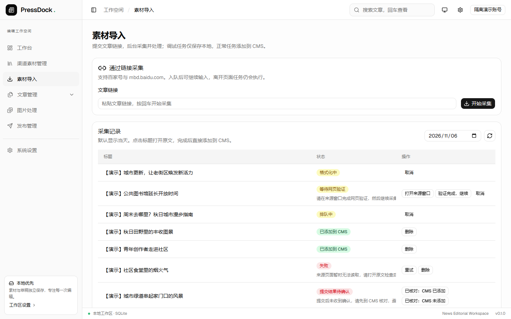
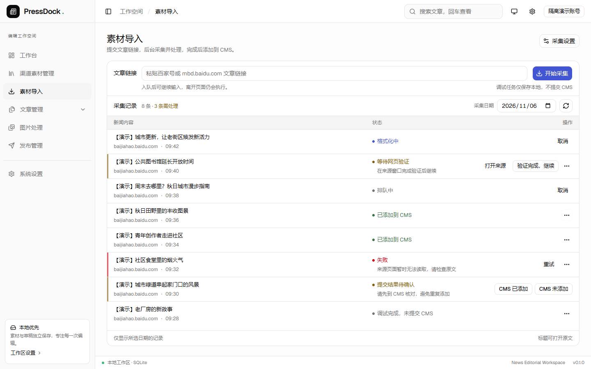

# 素材导入页紧凑版验收

日期：2026-11-06。已按[确认设计稿](import-ui-design-2026-11-06.md)完成真实 React 页面改造；本记录区别于此前的静态设计预览。

## 实施范围

- 页头为 22px，提供现有采集设置入口；36px 链接输入与主按钮、32px 工具栏控件合并到一个工作区。
- 三列为新闻内容、状态、操作。标题伸展，副行显示来源域名和本地创建时间，悬停查看完整值；状态点配合原有阶段文案。
- 表头 32px、常规行 60px。全部错误及警告保留，必要时换行增高；记录区独立滚动，固定表头、输入区、工具栏和底部说明。
- 按工作区实测宽度响应侧栏变化：不足 640px 使用卡片，640–959px 使用紧凑表格，960px 起使用宽表格。卡片操作至少 40px，输入 44px。
- 等待验证的取消、终态删除进入现有下拉菜单；删除和两种 CMS 核对继续二次确认。标记 CMS 未添加不会自动重试。
- 保留列 ID、`pressdock.table.import.v1`、显式列宽、原有服务、请求锁、日期恢复和草稿逻辑。超宽自定义列在记录区内滚动。
- `/import` 使用现有 `contained` 路由模式；局部密度和校样蓝仅作用于桌面素材导入工作区。Android 沿用原有布局、动作和前台执行说明。

入口为 `src/pages/Import/index.tsx`，桌面展示位于 `src/features/import/DesktopImportWorkspace.tsx` 和 `ImportRecord.tsx`；容器适配、列模型、局部样式分别独立。未修改采集服务、CMS、IPC、Rust、数据库、依赖或锁文件；保留工作区已有未提交修改。

## 截图

改造前（真实 React 页面，8 条隔离演示记录）：

改造后，1440×900（采用设计稿相同的 8 条记录与短异常文案）：

另保留[完整长错误场景](../artifacts/import-implementation-2026-11-06/after-long-errors.png)，用于与改造前比较；该场景允许行高增长，没有为首屏验收截断业务错误。其他尺寸：[1024px](../artifacts/import-implementation-2026-11-06/after-1024.png)、[768px](../artifacts/import-implementation-2026-11-06/after-768.png)、[390px 窄窗](../artifacts/import-implementation-2026-11-06/after-390.png)、[Android 390px](../artifacts/import-implementation-2026-11-06/android-390.png)。

## Ego 实装验收

使用 Ego Lite 0.6.2.7 检查真实 React 页面。宿主与账号明确标注“隔离演示”，标题带【演示】；所有写命令在替身 IPC 入口记录后拒绝，不连接 CMS、AI 或来源网站。演示数据仅在内存中调整，未修改线上素材。宿主、脚本、截图和原始 JSON 保存在 `artifacts/import-implementation-2026-11-06/`。

| 窗口     | 工作区宽度 | 布局     | 整页 / 记录区横向溢出 | 验收结果                                                           |
| -------- | ---------- | -------- | --------------------- | ------------------------------------------------------------------ |
| 1440×900 | 1150px     | 宽表格   | 0 / 0px               | 表头 y=283，8 行均为 60px；末行底部 y=795，小于记录区底部 y=806    |
| 1280×900 | 990px      | 宽表格   | 0 / 0px               | 8 条记录完整显示，底部说明可达                                     |
| 1024×900 | 734px      | 紧凑表格 | 0 / 0px               | 异常和操作允许换行，超出高度在记录区内滚动                         |
| 768×900  | 478px      | 卡片     | 0 / 0px               | 操作至少 40px，输入 44px；侧栏收起后工作区 646px，自动切回紧凑表格 |
| 390×844  | 356px      | 卡片     | 0 / 0px               | 输入 44px，底部 y=795；采集设置和主要操作可达                      |

额外验证：

- 24 条记录滚动 360px 后，表头 y=283、输入 y=161、工具栏 y=234、底部 y=806 均无位移。
- 长错误全部完整显示；等待验证、失败、提交结果待确认保留说明，不使用截断或隐藏错误来压缩行高。
- 更多菜单通过 Esc 关闭，并返回当前行的“更多操作”按钮。
- 删除、CMS 未添加核对和入队命令均被宿主拦截；删除失败仍保留 8 条记录，入队失败保留完整输入与错误。CMS 核对后自动重试次数为 0。
- 无效协议链接显示原有 HTTP/HTTPS 校验；日期切换空状态及刷新正常。
- “采集设置”实际导航至 `#/settings?tab=harvest&returnTo=import`，选中“采集与 AI 处理”。
- Android 390px：原有 8 张卡片、前台执行说明、44px 输入和系统设置入口保留，无整页横向溢出；触摸“打开来源窗口”准确触发 `show`，由宿主拦截，记录保留。
- 验收结束已关闭本任务 Ego 任务空间和本地演示服务。Ego 提示有更新，本轮未升级。

原始证据：[尺寸与滚动](../artifacts/import-implementation-2026-11-06/layout-checks.json)、[交互与写入拦截](../artifacts/import-implementation-2026-11-06/interaction-checks.json)、[Android 触摸](../artifacts/import-implementation-2026-11-06/android-checks.json)。Android 验收使用浏览器平台分支与触摸模拟，本轮未构建或安装 APK。

## 自动检查

新增 12 项桌面测试，覆盖全部状态、需处理统计、容器阈值切换、原文与设置入口、旧列宽恢复、完整异常、更多菜单焦点、删除及 CMS 确认、候选失效及选择、连续提交保护、失败保留输入、动作锁定、日期与刷新。原有测试继续覆盖通知刷新合并、跨日日期恢复和 Android 行为。

| 检查                                                                          | 结果                        |
| ----------------------------------------------------------------------------- | --------------------------- |
| `npm run lint`                                                                | 通过                        |
| `npm test`                                                                    | 33 个文件、269 项通过       |
| `node --test scripts/pagination-eval.test.mjs scripts/build-android.test.mjs` | 9 项通过                    |
| `npm run build`                                                               | TypeScript 与 Vite 构建通过 |
| `npm run format:check`                                                        | 通过                        |
| `git diff --check`                                                            | 通过                        |

一次与构建并行的全量测试中，原有渠道写入用例触发 5 秒超时；停止并行构建后单独复跑全量 269 项全部通过，未修改该用例或超时阈值。[最终测试原始结果](../artifacts/import-implementation-2026-11-06/tests.json)。本轮不涉及 Rust 或原生宿主改动。

方法沿用 [Unslop](../.agents/skills/unslop/SKILL.md)，作者 Damir Sokolovsky（[@heydamir](https://x.com/heydamir)），CC BY 4.0。
